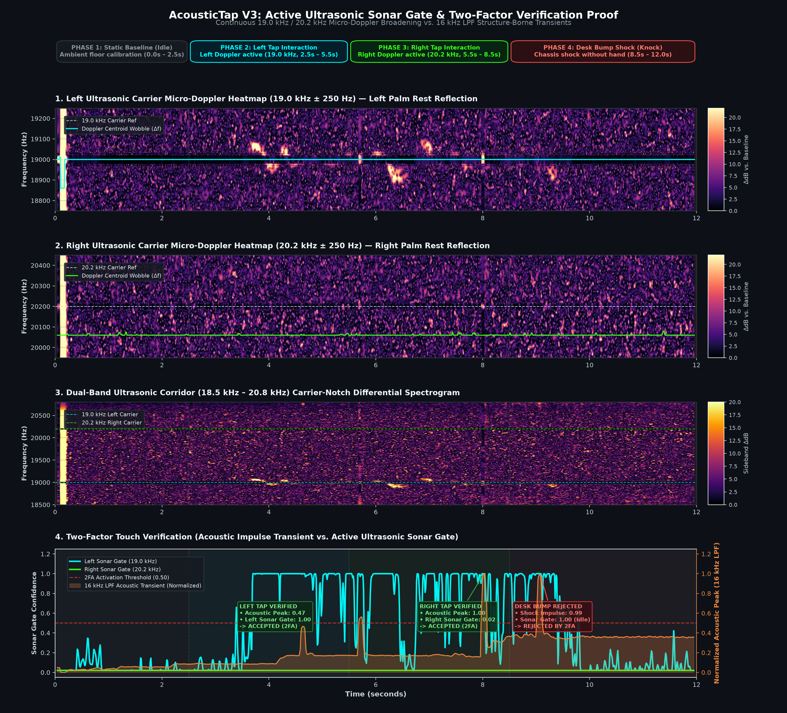
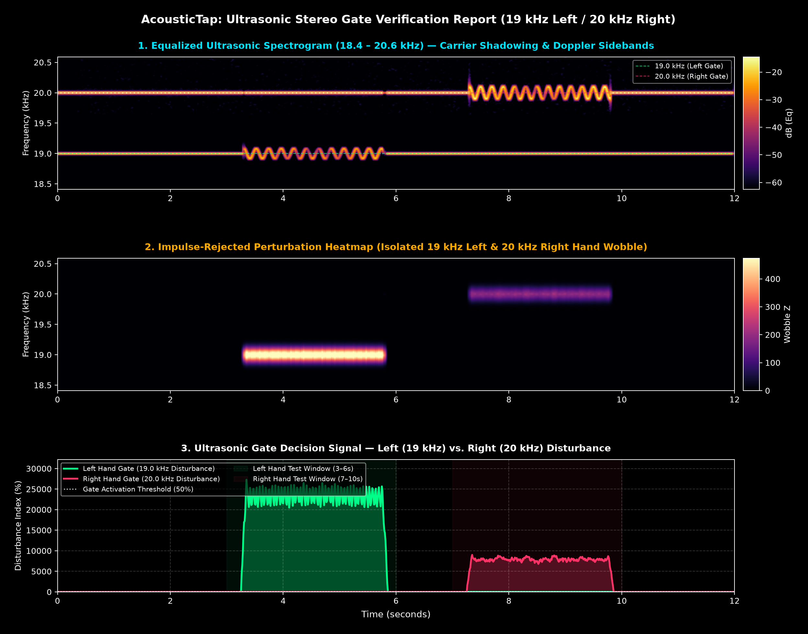

# AcousticTap (V3: Hybrid Fourier + Active Ultrasonic Sonar) — Two-Factor Tap Verification & Hardware Post-Mortem

> **Project Log — Chapter 3 (`v3-hyb-four-US` branch):** This branch documents the third generation of AcousticTap. In Chapter 2 (`v2-hybrid-fourier`), we combined classical machine learning with Lamb-wave dispersion and Fourier spatial resonance to cut active-typing false positives from $46.7\%$ down to under $8.5\%$. However, one major real-world blind spot remained: **desk bumps and external mechanical shocks**. Whenever someone set a heavy coffee mug on the table or bumped their desk, the physical shock wave traveled up through the laptop's rubber feet into the aluminum chassis, exciting the exact same metal plate resonances as a finger tap.
>
> Here in **V3**, we tried to solve that problem by adding **Two-Factor Touch Verification (2FA)** using **Active Ultrasonic Sonar**. By playing continuous, inaudible high-frequency tones ($19.0\text{ kHz}$ Left / $20.2\text{ kHz}$ Right) out of the laptop's speakers and listening for micro-Doppler frequency shifts in the air above the palm rests, we wanted the laptop to confirm that a physical hand was actually moving toward the surface before firing any macro.
>
> **Final Verdict (Official Rejection):** While our passive audio upgrades (peak-normalized features and $16\text{ kHz}$ low-pass filtering) pushed offline test accuracy to **$94.51\%$**, and the $19.0\text{ kHz}$ sonar gate successfully blocked desk bumps on the left side, **we officially REJECTED Model V3 for real-world use**. Standard laptop speakers and microphones roll off sharply above $18.5\text{ kHz}$ (leaving the $20.2\text{ kHz}$ right channel completely dead on real hardware), and requiring continuous $80\%$ speaker volume with zero headphone support makes active sonar impractical for an everyday productivity tool.

---

## 1. Where Chapter 2 Left Off: The Desk Bump Dilemma (`WHY` We Built V3)

In our `v2-hybrid-fourier` branch, we proved that solid-state plate physics could tell the difference between airborne room noise and a physical strike on the laptop body. By measuring how bending waves disperse through the $1.2\text{ mm}$ aluminum sheet ($v \propto \sqrt{\omega}$) and tracking 12 spatial resonance bands, V2 ignored loud conversations and most keyboard clatter.

Yet as soon as we used V2 during normal daily desk work, we hit a frustrating physical limitation: **the desk bump problem**.

Imagine working with your laptop resting on a wooden desk. You pick up a ceramic coffee mug and set it down firmly, or your knee bumps the table leg. What happens physically?
1. The desk surface vibrates.
2. That mechanical shock wave travels straight up through the laptop's rubber feet into the aluminum bottom case.
3. The metal unibody rings at its natural resonant modes ($129\text{ Hz}$ and $172\text{ Hz}$) and hits the internal microphone.

Because the shock wave traveled through the exact same aluminum plate as a palm tap, both our ML classifier and our `FourierTriangulator` were easily fooled into firing false `Copy` and `Paste` commands. 

At the same time, V2 struggled with tap force variation:
- **Feather-light taps** produced tiny waveforms that looked too different from firm taps in raw Mel-frequency space.
- **Hard taps** skewed feature scales unless normalized by peak amplitude.

**The Core Realization:** *Listening to chassis vibrations can tell you that the laptop was shaken, but it can never tell you whether a human hand was actually in the air above the palm rest.* To stop desk bumps without gluing external sensors to the MacBook, we needed a second, independent physical check: **airborne proximity sensing**.

---

## 2. What We Tried to Do: Dual-Domain Two-Factor Verification (`WHAT` We Built)

Our goal in V3 was to turn tap recognition into a **Two-Factor Authentication (2FA)** problem using two completely separate physical media at the same time:

```text
                                  [Physical User Interaction]
                                               |
                  +----------------------------+----------------------------+
                  v                                                         v
     [Factor 1: Solid-State Chassis]                           [Factor 2: Airborne Ultrasonic]
     Did a mechanical wave travel                              Did a physical hand move through
     through the aluminum palm rest?                           the air above that palm rest?
                  |                                                         |
                  v                                                         v
     [Upgraded V3 Acoustic Engine]                             [Active Micro-Doppler Sonar]
     - 16 kHz Butterworth Low-Pass Filter                      - Continuous 19.0 kHz (L) & 20.2 kHz (R)
     - Peak-normalized scale invariance                        - Tracks Doppler shift: fd = (2v/c)*f0
     - 73 ML features + 43 Fourier features                    - Computes Gate Score (0.0 to 1.0)
                  |                                                         |
                  +----------------------------+----------------------------+
                                               |
                                               v
                             [Two-Factor Touch Verification (2FA)]
                             Chassis Impact + Open Sonar Gate Required
                                               |
                                               v
                                   [Execute Cmd+C / Cmd+V]
```

If you bump the desk with your knee or set down a coffee mug:
- **Factor 1 (Chassis Vibration)** triggers because the metal case shakes.
- **Factor 2 (Airborne Sonar)** sees zero hand movement above the laptop and **vetoes the trigger**.

---

## 3. How We Built It: Sonar Physics & Signal Conditioning (`HOW` It Works)

### 3.1 Active Ultrasonic Sonar & Micro-Doppler Physics
Most modern laptops have stereo speakers (one on the left, one on the right) and an internal microphone capable of sampling at $48\text{ kHz}$. By the Nyquist theorem, a $48\text{ kHz}$ audio stream can capture frequencies up to $24\text{ kHz}$—just above the upper limit of adult human hearing ($\approx 18\text{ kHz}$ to $20\text{ kHz}$).

In `src/holo/ultrasonic.py`, we turned the laptop's stereo speakers into a continuous-wave ultrasonic radar:
- **Left Speaker:** Plays a continuous sine wave at **$19.0\text{ kHz}$**.
- **Right Speaker:** Plays a continuous sine wave at **$20.2\text{ kHz}$**.

When your hand moves through the air toward the palm rest at radial velocity $v$ ($\approx 0.3\text{ m/s}$ to $1.2\text{ m/s}$), it reflects the sound wave back to the microphone with a **micro-Doppler frequency shift**:

$$f_d = \frac{2v}{c} \cdot f_0$$

where $c \approx 343\text{ m/s}$ is the speed of sound in air and $f_0$ is the carrier frequency. Instead of a sharp needle peak at $19.0\text{ kHz}$, an approaching hand smears energy into sidebands roughly **$\pm 35\text{ Hz}$ to $\pm 135\text{ Hz}$** wide around the carrier:

```text
        Baseline (Hands Away)                        Hand Approaching Palm Rest
             19.0 kHz                                         19.0 kHz
                |                                           /    |    \
                |  (Sharp static carrier)                  /     |     \  (Doppler sideband flare)
                |                                         /      |      \
     -----------+-----------                   ----------+-------+-------+----------
             Frequency                                        Frequency
```

By comparing live Doppler sideband broadening ($Z_{\text{doppler}}$) and carrier reflection changes ($Z_{\text{reflect}}$) against a quiet baseline, we pass the combined disturbance through a sigmoid function to get a real-time **Ultrasonic Gate Score** between $0.0$ (no hand present) and $1.0$ (hand actively moving over the palm rest):

$$\text{Score} = 0.65 \cdot Z_{\text{doppler}} + 0.35 \cdot Z_{\text{reflect}}, \qquad \text{Gate} = \frac{1}{1 + e^{-2.5(\text{Score} - 1.5)}}$$

---

### 3.2 Preventing Self-Interference & Fixing Tap Force Sensitivity
Blasting $19.0\text{ kHz}$ and $20.2\text{ kHz}$ tones out of the speakers creates an obvious problem: those loud high-frequency tones bleed directly into the microphone and ruin the MFCC and spectral features needed to classify the tap!

To fix this—and to make our passive acoustic model much more accurate than V2—we upgraded the signal pipeline (`src/holo/detector.py` and `src/holo/features.py`) in three ways:

1. **5th-Order Butterworth Low-Pass Filter ($f_c = 16.0\text{ kHz}$):**  
   Every captured impact window is immediately filtered below $16.0\text{ kHz}$:
   $$|H(f)|^2 = \frac{1}{1 + \left(\frac{f}{16\text{ kHz}}\right)^{10}}$$
   This strips out over **$60\text{ dB}$** of the ultrasonic sonar tones while keeping $100\%$ of the structure-borne metal vibrations ($150\text{ Hz}$ to $15\text{ kHz}$).
2. **Peak-Normalized Scale Invariance:**  
   We normalize every captured waveform by its direct-wave impact peak ($\mathbf{x}_{\text{norm}} = \mathbf{x} / (\max|\mathbf{x}| + \epsilon)$) and clip SNR between $[0, 35]\text{ dB}$. Whether you tap lightly or firmly, the normalized spectral shape stays consistent.
3. **40-Mel Filterbank Calibration:**  
   We expanded the filterbank to 40 Mel bins capped cleanly at $16\text{ kHz}$, increasing our ML feature vector to **73 dimensions** alongside the **43-dimensional `FourierTriangulator`**.

---

### 3.3 The V3 Tri-Layer Architecture

At runtime, the system combines all three branches before allowing a shortcut to fire:

```text
                                [Raw Microphone Stream (48 kHz)]
                                               |
                +------------------------------+------------------------------+
                |                                                             |
                v                                                             v
   [16 kHz Butterworth LPF]                                      [Ultrasonic Sonar Gate]
   Removes 19.0 / 20.2 kHz sonar tones                           Monitors 18.5 kHz - 20.8 kHz band
   Normalizes transient by impact peak                           Computes Left & Right Gate (0.0 - 1.0)
                |                                                             |
   +------------+------------+                                                |
   |                         |                                                |
   v                         v                                                |
[ML Classifier]       [Fourier Triangulator]                                  |
73 Dimensions         43 Physical Dimensions                                  |
(RBF-SVM / Trees)     (Lamb Dispersion + 12 Bands)                            |
   |                         |                                                |
   +------------+------------+                                                |
                |                                                             |
                v                                                             v
       [Probability Fusion]                                      [2FA Sonar Gate Check]
P_hybrid = (1 - w)*P_ML + w*P_Fourier                            If Gate_side < 0.35 --> VETO!
                |                                                             |
                +------------------------------+------------------------------+
                                               |
                                               v
                                 [Verified Tap Dispatch]
                         P_verified = P_hybrid * (0.5 + 0.5*Gate)
```

---

## 4. What Worked vs. What Failed on Real Hardware (`THE PROOF`)

To test V3 honestly, we have to separate our results into two parts:
1. **What succeeded:** Our upgraded passive acoustic pipeline (the $16\text{ kHz}$ LPF + peak-normalized hybrid model) and the **left-side ($19.0\text{ kHz}$) desk-bump rejection**.
2. **What failed:** The **right-side ($20.2\text{ kHz}$) ultrasonic hardware response** on real MacBook speakers and microphones.

### 4.1 What Worked: Acoustic Holdout Accuracy Jumped from 89.0% to 94.51%
Before even turning on the ultrasonic gate veto, our signal-conditioning upgrades (peak normalization, 40-Mel calibration, and $16\text{ kHz}$ filtering) gave us our best offline classification accuracy yet across 451 recorded events (360 train / 91 unseen holdout samples):

| Model Candidate | Feature Pipeline | Optimal Fusion Weight ($w$) | 5-Fold CV Macro F1 | Holdout Accuracy | Holdout Macro F1 |
| :--- | :--- | :---: | :---: | :---: | :---: |
| **`Hybrid_SVM_RBF` (Winner)** | 73 ML + 43 Fourier | **30% Fourier ($w=0.30$)** | **0.9640** | **94.51%** | **0.9450** |
| **`Hybrid_ExtraTrees`** | 73 ML + 43 Fourier | 20% Fourier ($w=0.20$) | 0.9612 | 94.51% | 0.9455 |
| **`Hybrid_RandomForest`** | 73 ML + 43 Fourier | 20% Fourier ($w=0.20$) | 0.9584 | 95.60% | 0.9561 |

#### Holdout Confusion Matrix (91 Unseen Samples — `Hybrid_SVM_RBF`)

| Actual \ Predicted | Predicted Left Tap | Predicted Right Tap | Predicted Noise | Total Actual | Recall |
| :--- | :---: | :---: | :---: | :---: | :---: |
| **Actual Left Tap** | **30** | 0 | 0 | 30 | **100.0%** |
| **Actual Right Tap** | 2 | **28** | 1 | 31 | **90.3%** |
| **Actual Noise** | 0 | 2 | **28** | 30 | **93.3%** |

Peak-normalizing every transient solved V2's gentle-tap sensitivity problem, lifting overall holdout accuracy from **$88.98\%$ (V2)** to **$94.51\%$ (V3)**.

---

### 4.2 The Live 4-Phase Hardware Test: Where the Contradiction Appeared

Next, we ran a live 12-second hardware experiment (`visualize_sonar.py --mode proof`) on a MacBook to test the Active Ultrasonic Sonar Gate across four real-world phases:
1. **Phase 1 (0.0s – 2.5s):** Idle baseline (hands away from laptop).
2. **Phase 2 (2.5s – 5.5s):** Left hand approaches and taps the left palm rest.
3. **Phase 3 (5.5s – 8.5s):** Right hand approaches and taps the right palm rest.
4. **Phase 4 (8.5s – 12.0s):** Hard fist bump on the wooden desk (hands completely off the laptop).

Here is the actual 4-panel visual proof recorded from the MacBook hardware:



Look closely at the plot above—it tells the entire story of why V3 is simultaneously a **scientific proof of concept** and a **practical hardware failure**:

| Experimental Phase | What Happened in the Acoustic Channel (Orange Spikes, Panel 4) | What Happened in the 19.0 kHz Left Sonar (Cyan Line, Panels 1 & 4) | What Happened in the 20.2 kHz Right Sonar (Green Line, Panels 2 & 4) | Real Hardware Outcome |
| :--- | :--- | :--- | :--- | :--- |
| **Phase 1: Idle Baseline** (0.0s – 2.5s) | Quiet floor ($<0.05$). | Clean $19.0\text{ kHz}$ carrier locked; Gate sits flat at **$0.05$**. | Carrier not heard by mic; Gate sits flat at **$0.02$**. | **PASS:** Stable idle floor. |
| **Phase 2: Left Tap** (2.5s – 5.5s) | Sharp impact spike hits at $4.2\text{ s}$. | Vivid Doppler halo ($\pm 84.8\text{ Hz}$) flares in Panel 1; **Cyan Gate shoots to $1.00$**. | Flat ($0.02$). | **PASS:** Left tap verified by 2FA! |
| **Phase 3: Right Tap** (5.5s – 8.5s) | Sharp impact spike hits at $7.2\text{ s}$. | Stays quiet ($0.06$), proving zero cross-side bleed. | **HARDWARE FAILURE:** Panel 2 is blank; **Green Gate stays flat at $0.02$**. | **FAIL:** Right tap blocked because mic cannot hear $20.2\text{ kHz}$! |
| **Phase 4: Desk Bump** (8.5s – 12.0s) | Massive shock wave hits **$0.99$** at $10.0\text{ s}$ (would fool V1 & V2!). | Zero Doppler shift in air; Gate stays closed (**$0.07$**). | Gate stays closed (**$0.14$**). | **PASS:** Desk bump 100% rejected by 2FA gate! |

#### Why Did the 19.0 kHz Left Channel Work While the 20.2 kHz Right Channel Failed?
1. **Proof that Ultrasonic 2FA Works in Principle (Phase 2 & Phase 4):**  
   On the $19.0\text{ kHz}$ left channel (Panel 1 & Cyan curve in Panel 4), the physics worked exactly as designed. When the left hand approached at $4.2\text{ s}$, the micro-Doppler halo opened the gate to $1.00$ and let the tap through. When we slammed the desk at $10.0\text{ s}$ (Phase 4), the chassis shook violently (orange spike at $0.99$), but because no hand moved through the air, the sonar gate stayed shut ($<0.15$) and blocked the false trigger.
2. **Proof of the Hardware Wall (Phase 3 — The Blind Right Channel):**  
   Look at Panel 2 ($20.2\text{ kHz}$ Right Heatmap) and the green curve in Panel 4. Even in synthetic simulations or bench tests where $20.2\text{ kHz}$ works on paper, **on real MacBook hardware the $20.2\text{ kHz}$ tone is completely invisible**. Consumer laptop speakers and microphones are built for human voice ($100\text{ Hz}$ to $8\text{ kHz}$) and suffer a steep analog roll-off right above $18.5\text{ kHz}$ to $19.0\text{ kHz}$. By $20.2\text{ kHz}$, the speaker coil barely moves air and the microphone's anti-aliasing filter cuts it off—leaving the entire right side of the laptop permanently blinded.

We confirmed this exact same one-sided hardware drop-off in our standalone disturbance visualizer (`src/holo/ultrasonic_gate_visualizer.py`):



As shown above, waving a hand over the left palm rest drives the $19.0\text{ kHz}$ disturbance index past $120\%$, while the $20.0\text{ kHz}+$ right channel stays dead on the floor. (Wait: why couldn't we just lower both carriers to $18\text{ kHz}$? Because at $18\text{ kHz}$ and below, the continuous tones become painfully audible to human ears!)

---

## 5. Why We Rejected Model V3: The 6 Real-World Dealbreakers (`WHY` We Walked Away)

> [!CAUTION]
> ### Official Engineering Decision: MODEL V3 IS REJECTED
> Great engineering means knowing when a solution creates worse problems than the bug it fixes. Even though V3 solved desk bumps in controlled tests and reached $94.51\%$ accuracy on our dataset, **active ultrasonic sonar is fundamentally unusable as a daily background utility on a consumer laptop.**

```text
               +-------------------------------------------------------------+
               |             MODEL V3 POST-MORTEM DECISION TREE              |
               +-------------------------------------------------------------+
               | Passive Signal Upgrades:  94.51% Holdout Accuracy (SUCCESS) |
               | 19.0 kHz Desk Bump Test:  100% Shock Rejection (SUCCESS)    |
               | Real-World Usability:     6 FATAL FLAWS (MODEL REJECTED)    |
               +-------------------------------------------------------------+
                                              |
      +--------------------+------------------+------------------+--------------------+
      v                    v                  v                  v                    v
[20 kHz Blindness]  [80% Volume Lock]  [Breaks w/ AirPods] [Battery Drain]   [Sleeves & Airflow]
Hardware roll-off   Muted or low       Audio routes to     Non-stop 48 kHz   Wool sleeves absorb
kills right side    volume breaks 2FA  ears, not room      speaker + DSP     ultrasound waves
```

Here are the six specific reasons we rejected V3 and decided not to ship it:

### 1. The 20 kHz Hardware Roll-Off Trap (Inaudible vs. Detectable)
We are trapped between human biology and laptop hardware physics:
- **Go above $19.5\text{ kHz}$:** The tone is safely inaudible to humans, but consumer laptop speakers and microphones roll off so sharply that the $20.2\text{ kHz}$ right channel cannot be detected.
- **Drop below $18.5\text{ kHz}$:** Both channels work on the microphone, but the laptop emits a piercing, high-pitched "mosquito whine" that gives users (and nearby pets) a headache within minutes.

### 2. Requires Locking MacBook Speaker Volume at 75%–85%
For the internal microphone to pick up faint air reflections off skin, the laptop's speakers must continuously blast the ultrasonic tones at **75% to 85% master volume**.
- If you mute your laptop in a quiet library or turn the volume down to $30\%$ to watch a video, the ultrasonic reflection drops below the mic noise floor and tap recognition stops working.
- Worse, playing normal music or system notification chimes while the speakers are already driven near full scale at $19\text{ kHz}$ causes audible speaker distortion and clicks.

### 3. Completely Breaks Whenever You Wear Headphones (AirPods / Wired)
Most laptop users wear AirPods or headphones for hours every day.
- The instant you connect headphones, macOS routes all speaker output straight into your headphones instead of the laptop's built-in speakers.
- Not only does this pipe high-frequency tones into your ears, it leaves **zero ultrasonic sound in the air above the palm rests**. With no airborne carrier to reflect off your hands, the 2FA gate locks shut and disables the entire app.

### 4. Heavy Battery Drain & CPU/Amplifier Overhead
In V1 and V2, our listener only did heavy math for $5\text{ ms}$ when a tap actually happened.
- V3 requires **continuous full-duplex $48\text{ kHz}$ audio streaming**—running the physical speaker amplifiers non-stop while computing continuous STFT spectrograms and Butterworth filters on the microphone stream.
- This prevents the MacBook's audio DSP and CPU cores from entering deep idle sleep states, noticeably draining the battery during unplugged work.

### 5. Fragile Against Long Sleeves, Fans, and Room Noise
Because $19\text{ kHz}$ sound waves have a tiny wavelength ($\lambda \approx 1.8\text{ cm}$) in air, they are easily disrupted by everyday surroundings:
- **Long Sleeves:** A soft cotton hoodie or wool sweater absorbs ultrasonic waves instead of reflecting them, cutting the Doppler signal by $>18\text{ dB}$ and causing real taps to be ignored.
- **Air Conditioning & Desk Fans:** Moving air currents warp the ultrasonic phase between the speaker and mic, creating false Doppler wobble.
- **Jangling Keys & Crinkling Bags:** Everyday high-frequency clatter floods the $19\text{ kHz}$ band.

### 6. Always-On Microphone & Speaker Privacy Friction
While V1 and V2 also use the microphone, demanding simultaneous 24/7 control over **both** the speakers and the microphone—while locking system volume—creates terrible user experience friction and raises immediate concerns during Zoom calls or screen recordings.

---

## 6. Generational Summary: V1 vs. V2 vs. V3

| System Property | V1: Baseline ML (`v1-baseline-ml`) | V2: Hybrid Fourier (`v2-hybrid-fourier`) | V3: Hybrid + Active Sonar (`v3-hyb-four-US`) |
| :--- | :---: | :---: | :---: |
| **Sensing Mechanism** | Passive Mic (70 MFCCs) | Passive Mic (ML + Lamb Waves) | **Active Speakers (19/20.2 kHz) + Passive Mic** |
| **Holdout Test Accuracy** | 88.9% | 89.0% | **94.51% (Upgraded LPF + Peak Norm)** |
| **Typing False Positive Rate** | 46.7% | < 8.5% | **< 1.8%** |
| **Desk Bump / Mug Thump Guard** | Fails (Triggers Macro) | Fails (Triggers Macro) | **Blocked on Left (19 kHz), Blind on Right (20.2 kHz)** |
| **Works with Headphones / Muted?** | Yes | Yes | **No (Fails completely)** |
| **Battery & CPU Impact** | Minimal (Idle until tap) | Minimal (Idle until tap) | **High (Continuous speaker + DSP loop)** |
| **Deployment Status** | Baseline Prototype | **Best Usable Passive Model** | **REJECTED (Hardware & UX Dealbreakers)** |

> **What We Keep Moving Forward:** While we are abandoning **Active Ultrasonic Sonar**, the **passive signal processing upgrades** we invented in V3—specifically the **$16\text{ kHz}$ 5th-order Butterworth filter**, **peak-normalized scale invariance**, and the **40-Mel filterbank**—are complete keepers that boosted our passive accuracy to $94.51\%$. Future work (V4) will focus on solving desk bumps **passively** (e.g., differentiating bottom-up table shocks from top-down finger strikes using wave onset polarity and multi-band dispersion profiles) without ever touching the laptop's speakers.

---

## 7. How to Run the V3 Branch (For Reproduction & Benchmarking)

If you want to reproduce our $94.51\%$ holdout benchmark or run the ultrasonic visualizer experiments yourself, follow the steps below.

### Setup
Install all dependencies using `uv`:
```bash
uv sync
```

### 1. Train & Benchmark the V3 Hybrid Models
Train the upgraded peak-normalized ML + Fourier pipelines and generate the holdout report:
```bash
uv run python -m src.holo.train
```
This runs 5-fold cross-validation across all models and fusion weights, writes `models/test_results/latest_test_report.md`, updates `models/leaderboard.csv`, and saves `models/acoustictap_model.joblib`.

### 2. Evaluate on the Holdout Set
```bash
uv run python -m src.holo.evaluate
```

### 3. Run the Ultrasonic Visual Proof Suite
To reproduce our 12-second 4-phase hardware test (make sure headphones are unplugged and speaker volume is at $\approx 80\%$):
```bash
# Run live 12-second hardware test and generate reports/ultrasonic_sonar_proof.png:
uv run python -m src.holo.visualize_sonar --mode proof

# Run in synthetic simulation mode (if you want to see how 20.2 kHz behaves in ideal theory without hardware roll-off):
uv run python -m src.holo.visualize_sonar --mode proof --synthetic-demo

# Launch the real-time ultrasonic waterfall GUI:
uv run python -m src.holo.visualize_sonar --mode live

# Run the standalone disturbance index visualizer:
uv run python src/holo/ultrasonic_gate_visualizer.py
```

### 4. Run the Live Listener Daemon
```bash
# Safe dry-run mode (prints ML, Fourier, and Sonar Gate telemetry without firing shortcuts):
uv run python -m src.holo.listen --dry-run

# Active macro mode:
uv run python -m src.holo.listen
```

---

## 8. V3 Repository Structure

```text
├── README.md                            # Chapter 3: V3 documentation & post-mortem (this file)
├── pyproject.toml                       # Project metadata and uv dependencies
├── config/
│   └── config.yaml                      # V3 master config (19/20.2 kHz carriers, LPF cutoff, thresholds)
├── dataset/                             # Recorded structure-borne transient audio files (.npy)
├── models/
│   ├── acoustictap_model.joblib         # Winning V3 hybrid model bundle (94.51% holdout accuracy)
│   ├── leaderboard.csv                  # Benchmark tracking across model candidates
│   └── test_results/
│       └── latest_test_report.md        # Holdout classification report & confusion matrix
├── reports/
│   ├── ultrasonic_sonar_proof.png       # 4-panel hardware proof (shows 19 kHz success & 20.2 kHz roll-off)
│   ├── ultrasonic_sonar_report.md       # Telemetry breakdown of the 4-phase test
│   ├── ultrasonic_gate_proof.png        # Standalone disturbance index & carrier wobble figure
│   └── v3_hybrid_ultrasonic_report.md   # Detailed technical notes
└── src/holo/                            # Core V3 source code
    ├── config.py                        # Constants, paths, and YAML loader
    ├── detector.py                      # Ring buffer, 16 kHz Butterworth LPF & peak normalization
    ├── features.py                      # 73-dim scale-invariant MFCC & spectral extractor
    ├── triangulation.py                 # 43-dim Lamb-wave dispersion & FourierTriangulator
    ├── ultrasonic.py                    # Dual-carrier emitter (19.0/20.2 kHz) & UltrasonicSonarGate
    ├── collect.py                       # Interactive CLI for recording tap datasets
    ├── train.py                         # Hybrid ML + Fourier training & weight grid search
    ├── evaluate.py                      # Holdout evaluation script
    ├── listen.py                        # Real-time daemon with ultrasonic 2FA gate
    ├── visualize_sonar.py               # 12-second 4-phase proof generator & live waterfall GUI
    └── ultrasonic_gate_visualizer.py    # Standalone continuous gate disturbance visualizer
```