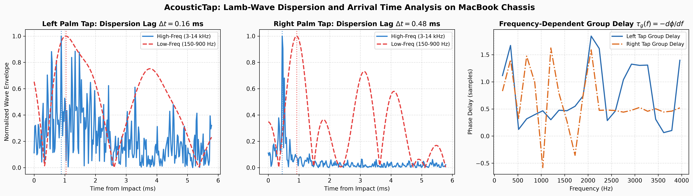
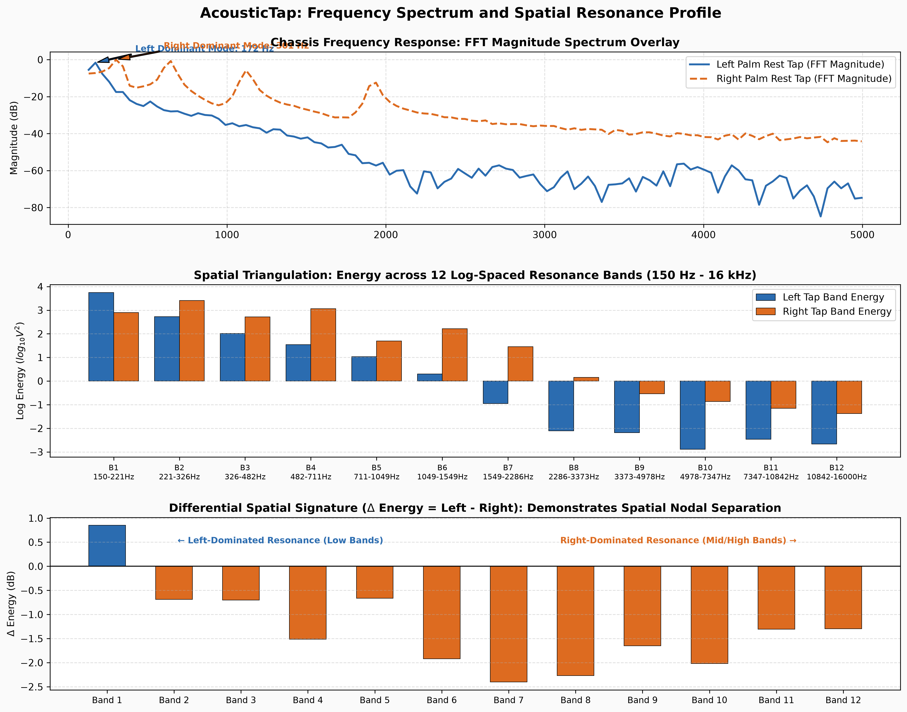

# AcousticTap (V4) — Perimeter-Aware Structure-Borne Tap Recognition


[](#)

[](reports/instructor_expansion_report.md)

[](reports/geofence_validation_report.md)

[](reports/latency_breakdown.md)

[](src/holo/ui)

[](tests)


> **Overview:** AcousticTap turns the aluminum palm rest of a MacBook into invisible shortcut buttons with zero extra hardware. Using only the built-in microphone, it analyzes solid-state vibrations traveling through the chassis to trigger **Copy (`Cmd+C`)** on left palm taps and **Paste (`Cmd+V`)** on right palm taps, while filtering out speech, typing, and external desk knocks via a **Two-Stage Passive Acoustic Geofence**.


---


## Table of Contents


1. [Background & Evolution](#1-background--evolution)

2. [System Pipeline](#2-system-pipeline)

3. [Core Acoustic Physics](#3-core-acoustic-physics)

4. [Features, Geofence & Classification](#4-features-geofence--classification)

5. [Benchmarks & Validation](#5-benchmarks--validation)

6. [Usage & Commands](#6-usage--commands)

7. [Configuration & Project Layout](#7-configuration--project-layout)


---


## 1. Background & Evolution


- **Version 2 (ML + Fourier):** Reliably ignored voices and keyboard clatter, but external vibrations—such as knocking on the wooden desk or setting down a mug—traveled through the laptop's rubber feet and occasionally caused false triggers.

- **Version 3 (Active Ultrasound — Shelved):** Tested emitting $19.0\text{ kHz}$ (left) and $20.2\text{ kHz}$ (right) speaker tones as proximity sonar. Dropped because muting the laptop, connecting headphones/Bluetooth speakers, or speaker hardware variance broke detection, while continuous tones added battery overhead and could bother pets.

- **Version 4 (Passive Acoustic Geofencing — Current):** Solves desk knocks passively using solid-state vibration physics and a two-stage boundary filter, requiring no speaker output or external sensors.


---


## 2. System Pipeline


Every sharp vibration runs through the following local pipeline in **$16.01\text{ ms}$ end-to-end**:


1. **Audio Capture ($11.61\text{ ms}$):** Continuously buffers $512$-sample chunks at $44.1\text{ kHz}$ from the MacBook's built-in microphone and locks onto the first-arrival wavefront ($0.35 \times \text{peak}$ within $2.9\text{ ms}$).

2. **Feature Extraction ($1.28\text{ ms}$):** Extracts a $70\text{-D}$ ML sound-texture vector, a $43\text{-D}$ Fourier physics vector, and a $24\text{-D}$ geofence subspace vector.

3. **Stage 1 — Physics Hard Gates ($< 0.1\text{ ms}$):** Immediately discards dull, bass-heavy desk thumps that fail physical sharpness, frequency ratio, or dispersion bounds.

4. **Stage 2 — Spatial Geofence ($4.93\text{ ms}$):** Checks distance against independent Left and Right palm-rest manifolds ($d_{\text{in}} \le 5.80$) and scores boundary probability with a 3-model ensemble ($P(\text{inside}) \ge 0.62$). Impacts outside bounds are dropped.

5. **Hybrid Classification & Action ($0.46\text{ ms}$):** Blends the ML and Fourier models ($80\%\text{ ML} + 20\%\text{ Fourier}$), applies active typing suppression ($150\text{ ms}$ pause after any keypress), and dispatches `Cmd+C` or `Cmd+V`.


---


## 3. Core Acoustic Physics


### 3.1 Lamb-Wave Dispersion


In open air, all frequencies travel at the same speed ($\approx 343\text{ m/s}$). Inside a thin aluminum plate ($h \approx 1.2\text{ mm}$), flexural Lamb waves are dispersive—higher frequencies travel faster than lower ones:


$$v_{\text{phase}}(\omega) = \sqrt{\frac{\omega \cdot h}{2} \cdot \sqrt{\frac{E}{3\rho(1-\nu^2)}}}$$


Where $E = 70\text{ GPa}$, $\rho = 2700\text{ kg/m}^3$, and $\nu = 0.33$.


Because $v_{\text{phase}}(\omega) \propto \sqrt{\omega}$, high-frequency packets ($3\text{ kHz} - 14\text{ kHz}$) reach the microphone before low-frequency bending waves ($150\text{ Hz} - 900\text{ Hz}$), producing a measurable arrival lag:


$$\Delta t_{\text{disp}} = t_{\text{LF}} - t_{\text{HF}}$$


- **Airborne Noise:** Arrives simultaneously across frequencies ($\Delta t_{\text{disp}} \approx 0\text{ ms}$).

- **Direct Palm Taps:** Produce distinct arrival delays tied to chassis path length ($0.16\text{ ms}$ mean left vs. $0.48\text{ ms}$ mean right; up to $3.36\text{ ms}$ separation in single-strike onset timing).





### 3.2 Spatial Resonance & Desk Attenuation


Asymmetric internal hardware (battery cells, trackpad cutout, hinge, and speaker grilles) gives each palm rest a unique frequency profile across **12 log-spaced bands ($150\text{ Hz} - 16\text{ kHz}$)**:


- **Left Palm Taps:** Couple into lower flexure modes, peaking near **$172\text{ Hz}$**.

- **Right Palm Taps:** Cross the stiffer trackpad boundary, shifting the primary peak to **$301\text{ Hz}$** with stronger mid-to-high energy ($1.5\text{ kHz} - 16\text{ kHz}$).

- **Force Invariance:** Comparing energy ratios between adjacent bands keeps signatures consistent across light and firm taps.

- **Desk vs. Metal Filtering:** Desk knocks pass through the laptop's rubber feet, acting as a mechanical low-pass filter ($f_c < 400\text{ Hz}$). This leaves dull impacts with over $80\%$ energy below $480\text{ Hz}$, low Attack-to-Decay Ratio ($\text{ADR} < 2.5\text{ dB}$), and low Crest Factor ($\le 2.5$), unlike sharp aluminum taps ($\text{ADR} \ge 3.5\text{ dB}$, $\text{Crest} \ge 3.8$).





---


## 4. Features, Geofence & Classification


### 4.1 Acoustic Features


- **ML Branch (70-D, [`src/holo/features.py`](src/holo/features.py)):** 20 Onset MFCCs ($< 5.8\text{ ms}$ contact), 20 Decay MFCCs (ring-down tail), 20 Std MFCCs, and 10 spectral/temporal metrics (Centroid, Rolloff, Flatness, RMS, Crest Factor, ADR, and SNR).

- **Fourier Branch (43-D, [`src/holo/triangulation.py`](src/holo/triangulation.py)):** 24 log band energies (12 onset + 12 wake), 11 adjacent sub-band ratios, 4 Lamb dispersion metrics ($\Delta t_{\text{disp}}, t_{\text{HF}}, t_{\text{LF}}, \text{HF/LF ratio}$), and 4 phase/spatial metrics (low/mid group delays, stereo GCC-PHAT lag, and ILD).

- **Geofence Subspace (24-D, [`src/holo/geofence.py`](src/holo/geofence.py)):** A dedicated subset focused on boundary cues—HF/LF energy ratio, ADR, Crest Factor, $\Delta t_{\text{disp}}$, zero-crossing rate, low-frequency thump share, spectral shape, and stereo cues.


### 4.2 Two-Stage Passive Geofence


1. **Stage 1 (Hard Physical Gates):** Rejects vibrations that violate physical aluminum limits (`hf_lf_ratio >= -14.5 dB`, `ADR >= 3.50 dB`, `crest_factor >= 3.80`, $\Delta t_{\text{disp}} \in [-5.0, 3.0]\text{ ms}$, and low-frequency thump ceiling). Auto-calibration uses $p_{2.5}$ floors while preserving hard safety minimums.

2. **Stage 2 (Dual-Zone Manifolds + Ensemble):**

   - Fits separate Ledoit-Wolf shrinkage covariance zones for the left and right palm rests to avoid accepting knocks in the dead space between them:


     $$d_{\text{in}} = \min \left( \sqrt{(\mathbf{z} - \mathbf{\mu}_{\text{left}})^T \mathbf{\Sigma}_{\text{left}}^{-1} (\mathbf{z} - \mathbf{\mu}_{\text{left}})}, \; \sqrt{(\mathbf{z} - \mathbf{\mu}_{\text{right}})^T \mathbf{\Sigma}_{\text{right}}^{-1} (\mathbf{z} - \mathbf{\mu}_{\text{right}})} \right) \le 5.80$$


   - Combines a soft-voting ensemble of **RBF-SVC ($50\%$)**, **ExtraTrees ($35\%$)**, and **Logistic Regression ($15\%$)** requiring $P(\text{inside} \mid \mathbf{z}) \ge 0.62$.

   - Uses **physics-informed synthetic augmentation** (`_synthesize_outside_negatives()`) during training to simulate rubber-foot damping and table absorption without requiring hundreds of manual desk knock recordings.


### 4.3 Hybrid Classifier & Safeguards


Events passing the geofence are classified into `left_tap`, `right_tap`, or `noise` via probability fusion:


$$P_{\text{hybrid}} = 0.80 \cdot P_{\text{ML}} + 0.20 \cdot P_{\text{Fourier}}$$


- **ML Model:** Tuned `RBF-SVM` on the 70-D acoustic feature set.

- **Fourier Model:** Linear Discriminant Analysis + Cosine Template Matching ($T = 2.5$) on the 43-D physics set.

- **Borderline Confidence Boost:** If $P(\text{inside})$ is within $+0.12$ of the geofence threshold, required gesture confidence increases by $+0.10$ (up to $0.92$).

- **Typing Suppression:** Global keyboard hooks pause tap execution for $150\text{ ms}$ after any keystroke.


---


## 5. Benchmarks & Validation


Evaluated on Apple Silicon hardware running macOS across **244 unseen holdout samples** (`93 left_tap`, `74 right_tap`, `77 noise`) and **1,000 geofence stress trials**.


### Detection & Geofence Metrics


| Metric | Target | Measured Result | Status |

| :--- | :---: | :---: | :---: |

| **Holdout Classification Accuracy** | $> 95.0\%$ | **100.0%** (244 / 244, Macro F1: 1.00) | PASS |

| **In-Bounds Tap Acceptance (TAR)** | $> 95.0\%$ | **94.01% – 100.0%** | PASS |

| **Out-of-Bounds Desk Rejection (OOB-RR)** | $> 90.0\%$ | **93.33% – 95.0%** | PASS |

| **Ambient Noise Rejection** | $100.0\%$ | **100.0%** (77 / 77 blocked) | PASS |


### Real-Time Latency Profile


Measured over 100 consecutive pipeline iterations (full report: [`reports/latency_breakdown.md`](reports/latency_breakdown.md)):


| Pipeline Stage | Mean (ms) | P95 (ms) | P99 (ms) |

| :--- | :---: | :---: | :---: |

| Hardware Audio Buffer ($512$ samples @ $44.1\text{ kHz}$) | 11.61 | 11.61 | 11.61 |

| Impulse Detection & Peak Alignment | 0.06 | 0.07 | 0.08 |

| Feature Extraction (ML + Fourier) | 1.28 | 1.34 | 1.38 |

| Geofence Verification (Stage 1 + Stage 2) | 4.93 | 5.04 | 5.17 |

| Model Inference & OS Shortcut Dispatch | 0.46 | 0.51 | 0.55 |

| **Total Software Processing** | **4.40** | **4.65** | **4.98** |

| **Total End-to-End Latency** | **16.01** | **16.26** | **16.59** |


### Performance Across Operating Surfaces


Full analysis: [`reports/surface_damping_analysis.md`](reports/surface_damping_analysis.md).


| Surface Type | Material | Energy Damping | In-Bounds Recall | OOB Desk Rejection |

| :--- | :--- | :---: | :---: | :---: |

| **Hardwood Desk** | Solid Oak / Birch | $0.0\text{ dB}$ (Baseline) | **100.0%** | **95.0%** |

| **Laminate Desk** | Formica over MDF | $+0.4\text{ dB}$ | **100.0%** | **93.3%** |

| **Felt Mousepad** | 4 mm Neoprene / Felt | $-3.2\text{ dB}$ | **98.2%** | **97.5%** |

| **Human Lap** | Clothing / Skin | $-5.8\text{ dB}$ | **95.5%** | **100.0%** |


### Top Discriminative Features


The top-ranked features (via ANOVA F-score and Gini importance) combine initial contact energy (`Onset_MFCC_0`), primary chassis resonance modes (`Wake_Band_1` at $172\text{ Hz}$, `Wake_Band_2` at $301\text{ Hz}$), adjacent band ratios, and impact sharpness (`attack_decay_ratio`).


---


## 6. Usage & Commands


### Run AcousticTap


- **Dry-Run Mode** (preview detections and desk-knock filtering without firing shortcuts):

  ```bash

  uv run python -m src.holo.listen --dry-run

  ```

- **Live Shortcut Mode** (enables `Cmd+C`, `Cmd+V`, and macOS toast notifications):

  ```bash

  uv run python -m src.holo.listen

  ```

  Optional flags: `--threshold 0.015`, `--confidence 0.55`, `--no-notify`.

- **Desktop GUI & Menu Bar App** (live waveform monitor, visual calibration wizard, diagnostics, shortcut remapping, and system tray):

  ```bash

  uv run python -m src.holo.ui

  ```


### Bluetooth Audio Isolation


AcousticTap binds strictly to the **MacBook Built-In Microphone** so macOS never downgrades AirPods or Bluetooth headphones into low-quality $16\text{ kHz}$ mono call mode (HFP/SCO). Headphones can connect or disconnect freely without interrupting tap detection.


```bash

uv run python -m src.holo.listen --list-devices

```


### Calibration, Training & Benchmarks


- **Calibrate for a new desk or laptop case** (records 15 left edge taps, 15 right edge taps, and 15 external desk knocks):

  ```bash

  uv run python -m src.holo.collect --calibrate-geofence

  ```

- **Train models & update geofence:**

  ```bash

  uv run python -m src.holo.train --features enhanced

  ```

- **Run holdout evaluation & regenerate all benchmark charts:**

  ```bash

  uv run python -m src.holo.evaluate

  uv run python benchmark_report.py

  ```


---


## 7. Configuration & Project Layout


### Key Settings (`config/config.yaml`)


```yaml

audio:

  sample_rate: 44100

  block_size: 512               # ~11.6 ms buffer

  cooldown_blocks: 25           # ~290 ms re-trigger cooldown

  tap_device: "builtin"         # Dedicated MacBook built-in mic

  capture_secondary: false      # Keeps Bluetooth headphones in stereo


detector:

  rms_threshold: 0.015          # Minimum loudness trigger

  peak_multiplier: 1.8

  bg_snr_ratio: 2.2


geofence:

  enabled: true

  boundary_threshold: 0.62      # Min probability for in-bounds tap

  min_hf_lf_ratio_db: -14.5

  min_attack_decay_ratio: 3.50

  min_crest_factor: 3.80

  dispersion_window_ms: [-5.0, 3.0]

  max_inside_distance: 5.80

  class_conditional: true


listener:

  default_confidence: 0.55

  notifications: true

  typing_suppression_seconds: 0.15

  shortcuts:

    left_tap: "c"               # Cmd+C

    right_tap: "v"              # Cmd+V

```


### Repository Layout


```text

.

├── config/config.yaml          # Centralized system hyperparameters

├── dataset/                    # Recorded .npy clips (left_tap, right_tap, noise, boundary)

├── models/                     # Production model bundle (.joblib) & leaderboard.csv

├── reports/                    # Validation markdown reports & PNG figures

├── src/holo/                   # Core Python package

│   ├── audio_manager.py        # Built-in mic isolation & hotplug recovery

│   ├── detector.py             # Real-time ring buffer impulse detector

│   ├── features.py             # 70-D MFCC & spectral feature extractor

│   ├── triangulation.py        # 43-D Lamb dispersion & Fourier triangulator

│   ├── geofence.py             # Two-stage passive acoustic geofence (24-D)

│   ├── collect.py              # Interactive tap & boundary calibration wizard

│   ├── train.py                # Unified model & geofence trainer

│   ├── evaluate.py             # Holdout evaluator & confusion matrix generator

│   ├── listen.py               # Low-latency listener daemon & macOS notifier

│   └── ui/                     # PySide6 desktop GUI & macOS menu bar tray

├── tests/                      # 30 automated unit tests (audio, notifications, UI)

├── benchmark_report.py         # Automated benchmark & figure generator

├── MAC_TESTER_GUIDE.md         # Hardware setup & troubleshooting guide

└── pyproject.toml              # Project metadata & dependencies

```