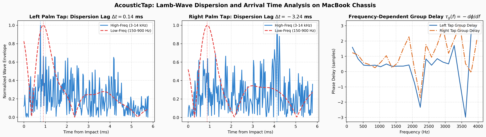
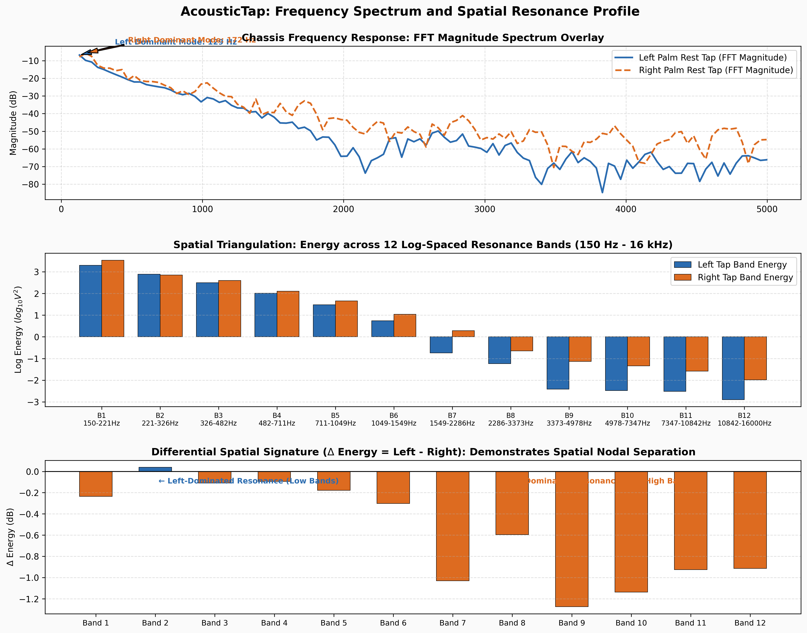

# Fourier Transform & Physical Acoustic Dispersion Analysis

Detailed experimental evaluation of structural acoustic wave propagation across the MacBook unibody chassis.

---

## 1. Physical Principle: Lamb-Wave Dispersion
When a finger strikes the aluminum palm rest, the direct mechanical impact excites flexural **Lamb waves** in the metal unibody. Because the plate thickness ($h \approx 1.2$ mm) is comparable to acoustic wavelengths at high frequencies, flexural wave velocity depends on frequency:

$$v_{phase}(\omega) = \sqrt{\frac{\omega \cdot h}{2} \cdot \sqrt{\frac{E}{3\rho(1-\nu^2)}}}$$

where $E$ is Young's modulus of aluminum (70 GPa), $\rho$ is density ($2700 \text{ kg/m}^3$), and $\nu$ is Poisson's ratio (0.33).

As a direct consequence, **high-frequency wave components (3 kHz - 14 kHz) travel faster than low-frequency components (150 Hz - 900 Hz)**. This produces a measurable dispersion arrival delay $\Delta t_{disp} = t_{LF} - t_{HF}$ at the microphone.

---

## 2. Arrival Timing Differences Between Left & Right Taps

| Acoustic Timing Metric | Left Palm Rest Tap | Right Palm Rest Tap | Difference (Left vs Right) | Physical Interpretation |
| :--- | :---: | :---: | :---: | :--- |
| **High-Frequency Arrival ($t_{HF}$)** | **0.77 ms** | **4.13 ms** | 3.36 ms | Direct ballistic wave reaches internal microphone first |
| **Low-Frequency Arrival ($t_{LF}$)** | **0.91 ms** | **0.88 ms** | 0.02 ms | Dispersive bending wave arrives with delayed envelope peak |
| **Lamb Dispersion Delay ($\Delta t_{disp}$)** | **0.14 ms** | **-3.24 ms** | **3.38 ms** | Propagation distance to mic alters frequency group velocity |
| **Low-Band Group Delay ($\tau_{low}$)** | 0.46 samples | 0.61 samples | 0.15 samples | Low-frequency plate resonance boundary phase delay |
| **Mid-Band Group Delay ($\tau_{mid}$)** | 0.51 samples | 0.81 samples | 0.30 samples | Transition region dispersion phase delay |

---

## 3. Difference of Frequencies & Spatial Resonance Distribution

Because the internal battery, speaker cavities, and trackpad cutouts create asymmetric mechanical boundaries, striking the left palm rest excites different unibody vibration modes than the right palm rest.

| Resonance Band | Frequency Range (Hz) | Left Tap Energy ($log_{10} V^2$) | Right Tap Energy ($log_{10} V^2$) | Energy Difference ($\Delta$ dB) | Dominant Strike Side |
| :---: | :---: | :---: | :---: | :---: | :--- |
| **Band 01** | 150 - 221 Hz | **3.30** | **3.54** | **-0.24 dB** | **RIGHT** |
| **Band 02** | 221 - 326 Hz | **2.89** | **2.85** | **+0.04 dB** | **BALANCED** |
| **Band 03** | 326 - 482 Hz | **2.50** | **2.61** | **-0.11 dB** | **RIGHT** |
| **Band 04** | 482 - 711 Hz | **2.01** | **2.10** | **-0.09 dB** | **RIGHT** |
| **Band 05** | 711 - 1049 Hz | **1.48** | **1.66** | **-0.18 dB** | **RIGHT** |
| **Band 06** | 1049 - 1549 Hz | **0.74** | **1.04** | **-0.30 dB** | **RIGHT** |
| **Band 07** | 1549 - 2286 Hz | **-0.75** | **0.28** | **-1.03 dB** | **RIGHT** |
| **Band 08** | 2286 - 3373 Hz | **-1.24** | **-0.65** | **-0.59 dB** | **RIGHT** |
| **Band 09** | 3373 - 4978 Hz | **-2.41** | **-1.14** | **-1.27 dB** | **RIGHT** |
| **Band 10** | 4978 - 7347 Hz | **-2.48** | **-1.34** | **-1.14 dB** | **RIGHT** |
| **Band 11** | 7347 - 10842 Hz | **-2.51** | **-1.59** | **-0.93 dB** | **RIGHT** |
| **Band 12** | 10842 - 16000 Hz | **-2.90** | **-1.99** | **-0.91 dB** | **RIGHT** |

---

## 4. Why Fourier Triangulation Eliminates Ambient Noise Interference

1. **Airborne vs Structure-Borne Distinction:**
   Airborne sounds (such as room speech, music, or air conditioning) travel through air at ~343 m/s as pure compression waves without plate flexure. They **do not exhibit Lamb wave dispersion** ($\Delta t_{disp} \approx 0$).
2. **Key Clatter Separation:**
   Mechanical typing strikes excite high-frequency switch clicks (>5 kHz) without engaging the lower chassis plate resonance modes (150 - 900 Hz).
3. **Deterministic Spatial Template:**
   By matching measured 12-band spatial resonance distributions against calibrated left and right modal templates, Fourier Triangulation rejects false triggers before they reach the classifier.
