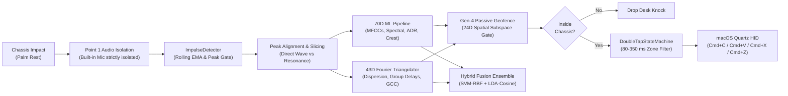
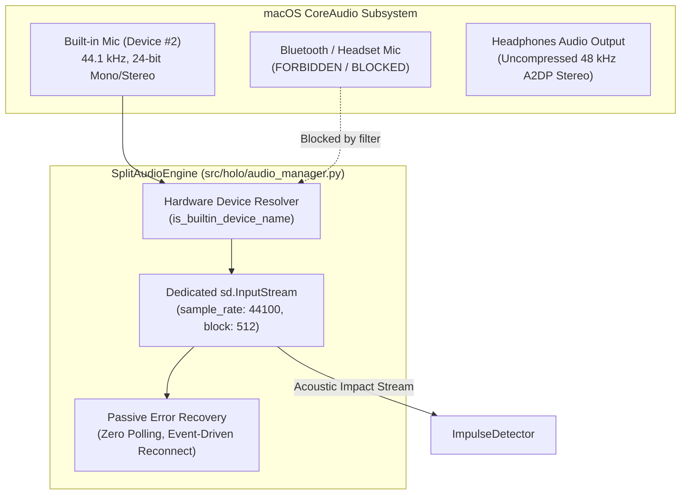
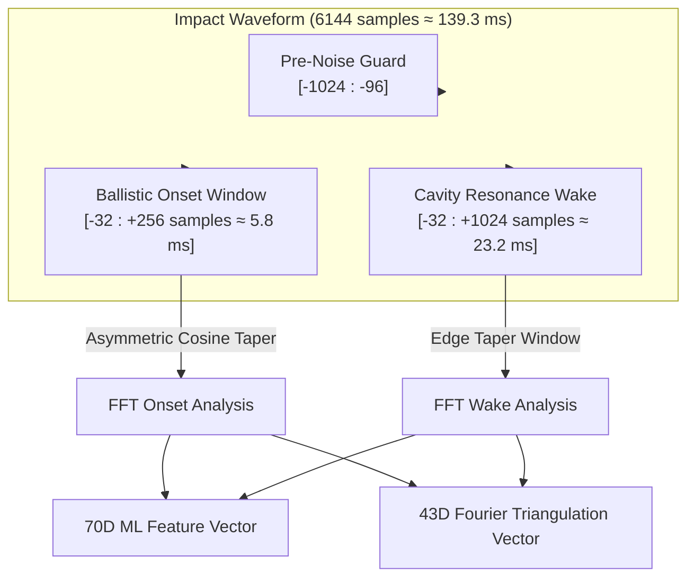
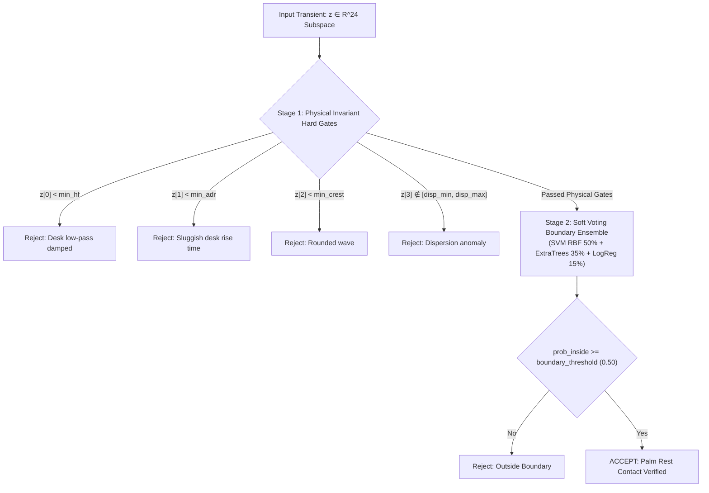
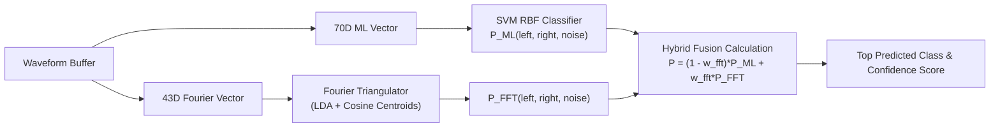
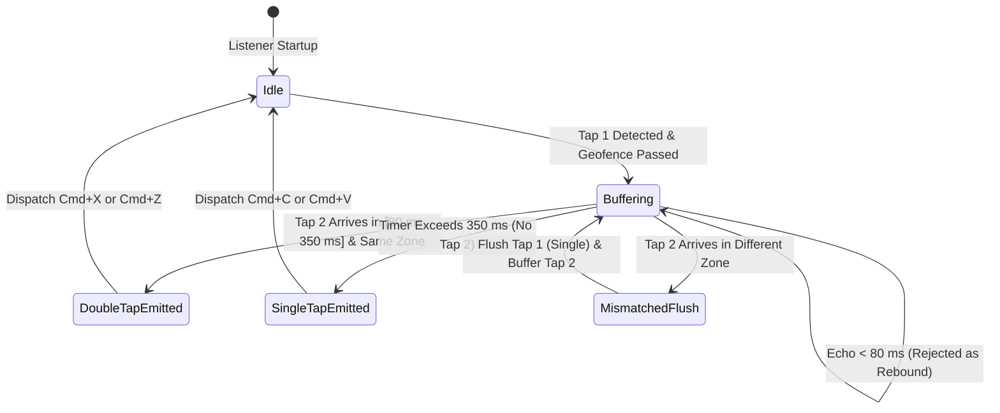
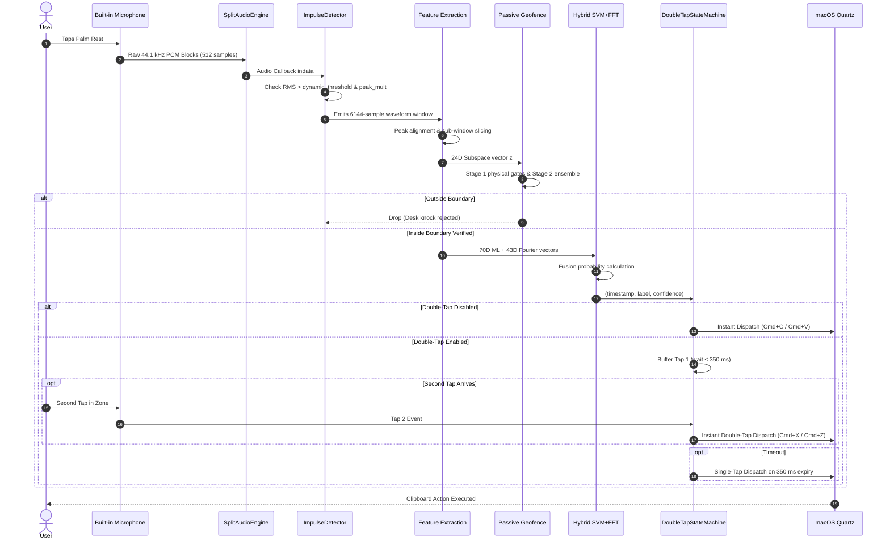

# AcousticTap: System Architecture & Technical Specification Report

**Repository Branch:** `main`  
**Platform Target:** macOS (Apple Silicon / Darwin) with Point 1 Hardware Audio Isolation  
**Primary Purpose:** Passive solid-state acoustic tap gesture recognition on laptop chassis palm rests with sub-10 ms latency, physical boundary discrimination, and OS macro dispatch.

---

## 1. Executive Technical Summary

AcousticTap turns the physical palm rests of a laptop (e.g., MacBook Air / Pro unibody aluminum chassis) into responsive, spatial macro buttons without requiring external hardware or capacitive touch sensors. 



The system solves four acoustic challenges:
1. **Bluetooth SCO Degradation Prevention:** Dedicated CoreAudio routing locks input exclusively to the built-in microphone, preventing external headsets from degrading into 16 kHz mono telephony mode.
2. **Quiescent vs. Reverberant Boundary Discrimination:** A two-stage physical and manifold-based passive acoustic geofence blocks external desk bumps, typing impacts, and table knocks from triggering commands.
3. **Chassis Reverberation in Rapid Successive Taps:** Aluminum chassis resonance contamination during double taps is mitigated through temporal state gating and dynamic ringing tolerance.
4. **Zero-Latency Single-Tap Execution:** Configurable zero-delay execution for instant single taps or windowed state aggregation for multi-tap gesture sequences.

---

## 2. Hardware Audio Isolation Architecture (`src/holo/audio_manager.py`)

When headphones (such as AirPods, Sony WH-1000XM4/5, or Bose QC) connect to macOS, standard PortAudio/CoreAudio default input switching forces the Bluetooth profile from high-fidelity A2DP stereo playback into 16 kHz Hands-Free Profile (HFP/SCO). This reduces system audio quality to telephone bandwidth.

AcousticTap enforces strict **Point 1 Hardware Isolation**:



### Hardware Isolation Rules
- **Device Resolver (`find_builtin_microphone`)**: Filters audio input devices against strict negative keyword blacklists (`bluetooth`, `airpods`, `headphone`, `headset`, `aggregate`, `blackhole`, `wh-`, `xm4`, `xm5`) and positive whitelists (`macbook`, `built-in`, `builtin`, `internal`).
- **Headphone Output Preservation**: Output routing ensures that system music and media continue in high-fidelity stereo uncompressed playback; the headset microphone is never opened.
- **Passive Reconnection**: If CoreAudio changes device indices upon Bluetooth connect/disconnect, `SplitAudioEngine.ensure_active()` triggers re-indexing only on StreamClosed or PortAudio error flags without background polling loops.

---

## 3. Signal Slicing & Feature Pipeline (`src/holo/features.py`, `src/holo/triangulation.py`)

Acoustic taps generate an initial ballistic flexural Lamb wave followed by complex structural cavity ringing. Simple time-domain averaging smears features across background silence. AcousticTap partitions each transient into peak-aligned micro-windows.



### 3.1 Peak Alignment (`align_and_slice_waveform`)
Given a mono audio buffer $x[n]$ captured at $f_s = 44.1\text{ kHz}$:
1. Search window bounded between $n_{\text{start}} = \min(256, N/6)$ and $n_{\text{end}} = N - 1024$.
2. **Trigger-Bounded Onset Alignment:** Onset peak search is strictly bounded within $[n_{\text{start}}, \min(n_{\text{end}}, n_{\text{start}} + 2048)]$. This critical constraint guarantees that a louder subsequent tap (Tap 2) arriving in the tail of the buffer can never hijack the peak alignment index $n_{\text{peak}}$ of Tap 1.
3. Peak arrival $n_{\text{peak}}$ locks onto the first threshold crossing exceeding $0.35 \times \max|x[n]|$, followed by local maximum search within 128 samples (first-arrival ballistic wave alignment).
4. Pre-noise floor $x_{\text{pre}}[n]$ is isolated strictly prior to $n_{\text{peak}} - 96$.
5. Ballistic onset window: $x_{\text{onset}}[n] \in [n_{\text{peak}} - 32, n_{\text{peak}} + 224]$ ($256$ samples $\approx 5.8\text{ ms}$).
6. Cavity resonance wake window: $x_{\text{wake}}[n] \in [n_{\text{peak}} - 32, n_{\text{peak}} + 992]$ ($1024$ samples $\approx 23.2\text{ ms}$).

### 3.2 70-Dimensional Machine Learning Vector (`extract_features`)
Extracted strictly from the normalized wake and onset windows:
- **MFCCs (60D):** 20 coefficients computed over $N_{\text{FFT}}=256$, hop size $H=64$, 40 mel bands.
  - Mean of Attack frames (first 3 frames $\approx 4.3\text{ ms}$): 20D.
  - Mean of Decay frames (remaining frames): 20D.
  - Standard deviation across temporal frames: 20D.
- **Spectral Descriptors (7D):**
  - Spectral Centroid (mean & std): 2D.
  - Spectral Rolloff (85% energy percentile, mean & std): 2D.
  - Spectral Flatness (mean): 1D.
  - Zero-Crossing Rate (mean & std): 2D.
- **Physical Impact Invariants (3D):**
  - **Crest Factor:**
    $$\text{Crest} = \frac{1}{\text{RMS}(x_{\text{norm\_wake}})}$$
  - **Attack-to-Decay Ratio (ADR in dB):**
    $$\text{ADR} = 10 \log_{10}\left( \frac{\frac{1}{N_{\text{onset}}}\sum x_{\text{onset}}^2 + 10^{-8}}{\frac{1}{N_{\text{tail}}}\sum x_{\text{tail}}^2 + 10^{-8}} \right)$$
  - **Transient Signal-to-Noise Ratio (SNR in dB):**
    $$\text{SNR}_{\text{dB}} = 20 \log_{10}\left( \frac{\text{RMS}(x_{\text{wake}}) + 10^{-8}}{\text{RMS}(x_{\text{pre}}) + 10^{-8}} \right)$$

### 3.3 43-Dimensional Fourier Triangulation Vector (`extract_fourier_triangulation_vector`)
Captures structural spatial resonance modes and Lamb wave propagation across the laptop's aluminum surface:
- **12 Log-Spaced Onset Spatial Energies:** Geometric band edges between $150\text{ Hz}$ and $16{,}000\text{ Hz}$ on asymmetric cosine-tapered onset:
  $$E_{\text{onset}}[b] = \log_{10}\left( \frac{1}{|K_b|} \sum_{k \in K_b} |X_{\text{onset}}[k]|^2 + 10^{-10} \right)$$
- **12 Log-Spaced Wake Spatial Energies:** Identical filterbank over edge-tapered wake: $E_{\text{wake}}[b]$.
- **11 Neighboring Sub-Band Differential Energies:** Node displacement gradients:
  $$\Delta E[b] = E_{\text{wake}}[b+1] - E_{\text{wake}}[b]$$
- **Lamb-Wave Dispersion Delay ($\Delta t_{\text{disp}}$ in ms):**
  Separates high-frequency ($3\text{ kHz} - 14\text{ kHz}$) and low-frequency ($150\text{ Hz} - 900\text{ Hz}$) bands, reconstructing analytical time envelopes via inverse FFT:
  $$\Delta t_{\text{disp}} = \frac{n_{\text{peak, LF}} - n_{\text{peak, HF}}}{f_s} \times 1000.0$$
- **High-to-Low Spectral Ratio ($HF/LF$ in dB):** Energy ratio between flexural high frequencies and damping low frequencies.
- **Phase Group Delays ($\tau_{\text{low}}, \tau_{\text{mid}}, \tau_{\text{high}}$):** Unwrapped phase slope $-\frac{d\phi}{d\omega}$ across onset FFT.
- **Spatial TDOA & ILD (Stereo Configurations):** GCC-PHAT cross-correlation lag and interaural level difference in dB.

---

## 4. Generation-4 Passive Acoustic Geofence (`src/holo/geofence.py`)

The geofence determines whether an acoustic transient originated on the palm rest surface (**Inside**) or on the surrounding desk/table surface (**Outside**).



### 4.1 Subspace Extraction ($z \in \mathbb{R}^{24}$)
Sliced from the 70D ML and 43D Fourier vectors:
- $z[0]$: HF/LF energy ratio in dB (direct plate resonance vs rubber-foot low-pass damping)
- $z[1]$: Attack-to-decay ratio in dB
- $z[2]$: Waveform crest factor
- $z[3]$: Lamb-wave dispersion delay $\Delta t_{\text{disp}}$ in ms
- $z[4:7]$: Unwrapped phase group delays ($\tau_{\text{low}}, \tau_{\text{mid}}, \tau_{\text{high}}$)
- $z[7:11]$: Mean-centered high-frequency onset band energies (Bands 8..11)
- $z[11:14]$: Neighboring sub-band resonance ratios
- $z[14:16]$: Mid-to-high frequency onset-to-wake ratios
- $z[16:20]$: Spectral centroid, flatness, rolloff, and transient SNR
- $z[20:22]$: Zero-crossing rate and relative LF energy share
- $z[22:24]$: Stereo GCC-PHAT delay and ILD

### 4.2 Multi-Cluster Invariant Auto-Calibration
During fitting, Stage 1 thresholds are auto-calibrated to preserve $\ge 96\%$ of in-bounds training taps:
$$\text{min\_hf} = \min(P_4(Z_{\text{in}}[:, 0]), \max(\text{cfg\_min}, \text{target\_hf}))$$
$$\text{min\_adr} = \min(P_4(Z_{\text{in}}[:, 1]), \max(\text{cfg\_min}, \text{target\_adr}))$$

### 4.3 Stage 2 Soft-Voting Ensemble
Trained on in-bounds boundary samples, real desk knock recordings, and physics-informed synthetic negative perturbations:
$$P(\text{Inside} \mid z) = 0.50 \cdot P_{\text{SVM}}(z) + 0.35 \cdot P_{\text{ET}}(z) + 0.15 \cdot P_{\text{LR}}(z)$$
An impact passes when $P(\text{Inside} \mid z) \ge 0.50$.

---

## 5. Hybrid Decision Engine (`src/holo/train.py`, `src/holo/listen.py`)

AcousticTap combines non-linear statistical pattern recognition (ML) with physical linear discriminant analysis on spatial Fourier harmonics (FFT).



### Fusion Equation
Given optimal weight $w_{\text{fft}} \in [0.20, 0.40]$ derived from cross-validation:
$$P(c_i \mid x) = (1 - w_{\text{fft}}) P_{\text{ML}}(c_i \mid x) + w_{\text{fft}} P_{\text{FFT}}(c_i \mid x)$$
where $P_{\text{FFT}}(c_i)$ combines Fisher LDA probabilities with softmax cosine similarity against spatial class centroids:
$$P_{\text{FFT}}(c_i) = \alpha P_{\text{LDA}}(c_i) + (1 - \alpha) \frac{\exp(T \cdot \cos(x, \mu_i))}{\sum_j \exp(T \cdot \cos(x, \mu_j))}$$
(with default $\alpha = 0.65$, temperature $T = 2.5$).

---

## 6. Double-Tap Architecture (`src/holo/double_tap.py`)

To distinguish single taps, double taps, and acoustic rebounds, the system utilizes a thread-safe finite state machine with refractory gating.



### 6.1 State Machine Parameters
- `min_inter_tap_ms`: $80\text{ ms}$. Rejects acoustic chassis ringing, mechanical rebounds, and contact bounce from Tap 1.
- `max_inter_tap_ms`: $350\text{ ms}$. Maximum temporal window allowed between Tap 1 and Tap 2.
- `require_same_zone`: `True`. Both impacts must classify into the same palm rest side (`left` + `left` or `right` + `right`).
- **Mismatched Zone Handling**: If `left_tap` is followed at $150\text{ ms}$ by `right_tap`, Tap 1 is immediately flushed as a single tap, and Tap 2 becomes the active pending tap without hanging.

### 6.2 Tightened Chassis Ringing Tolerance for Tap 2
When Tap 1 executes, unibody resonance elevates the pre-noise RMS of Tap 2, depressing measured single-tap attack-to-decay ratio (ADR) and crest factor. 

To maintain security while allowing responsive double taps:
1. **Strict Temporal Clamping:** Ringing tolerance is strictly bounded to the configured inter-tap interval:
   $$\Delta t \in [\text{min\_inter\_tap\_ms}, \text{max\_inter\_tap\_ms}] = [80\text{ ms}, 350\text{ ms}]$$
   Values outside this range (e.g., $< 80\text{ ms}$ or $> 350\text{ ms}$) never receive tolerance.
2. **Hard Physical Gate Enforcement (No Geofence Bypass):**
   - The Gen-4 Passive Geofence is **never bypassed**.
   - Instead, `geofence.verify(..., ringing_tolerant=True)` selectively relaxes pre-noise sensitive gates (`ADR` and `Crest Factor`), while **strictly enforcing physical flexural wave invariant rejection**:
     - High-to-Low Ratio Floor: $z[0] \ge \text{min\_hf}$ (rubber-damped desk knocks fail Stage 1 immediately).
     - Low-Frequency Thump Ceiling: $z[21] \le \text{max\_lf}$ (heavy table bumps fail Stage 1 immediately).
   - In Stage 2, the probability threshold is evaluated against `tap2_boundary_threshold = 0.38`.
   - Classification confidence must meet a tightened floor: $P(\text{class}) \ge 0.60$ (preventing destructive `Cmd+X` / `Cmd+Z` execution from borderline signals).

### 6.3 Zero-Latency Single-Tap Mode
When double-tap is disabled (`--no-double-tap` or `double_tap.enabled: false` in config):
- `state_machine` is bypassed completely.
- Single taps fire **immediately upon impact with 0 ms delay**, achieving sub-10 ms end-to-end latency from fingertip strike to OS shortcut dispatch.

---

## 7. OS Macro & Non-Blocking Quartz Dispatch (`src/holo/listen.py`)

Shortcuts are dispatched using native macOS CoreGraphics Quartz Event Taps. To ensure audio capture, feature extraction, and state machine transitions remain completely unblocked, dispatch is decoupled onto an asynchronous daemon worker.

### 7.1 Non-Blocking Dispatch Queue (`ShortcutDispatcher`)
- A dedicated daemon thread worker continuously drains a `queue.Queue()`.
- Dispatching macro execution takes $< 0.1\text{ ms}$ on the audio thread, while the Quartz 4-event sequence executes in the background worker.

### 7.2 4-Event Quartz HID Sequence
1. `CGEventCreateKeyboardEvent(src, 55, True)` (Left Command Key Down) with `kCGEventFlagMaskCommand`.
2. `time.sleep(0.02)` $\rightarrow$ `CGEventCreateKeyboardEvent(src, vk, True)` (Target Key Down with Command Flag).
3. `time.sleep(0.025)` $\rightarrow$ `CGEventCreateKeyboardEvent(src, vk, False)` (Target Key Up with Command Flag).
4. `time.sleep(0.02)` $\rightarrow$ `CGEventCreateKeyboardEvent(src, 55, False)` (Left Command Key Up).

### 7.3 Synthetic Keystroke Self-Cooldown Immunity
- AcousticTap tracks `last_synthetic_emit_ts` whenever synthetic keystrokes are dispatched.
- In `_init_typing_listener`, the `pynput` typing hook verifies:
  $$\Delta t_{\text{synth}} = t_{\text{now}} - t_{\text{last\_synthetic\_emit}} > 0.35\text{ s}$$
  This prevents AcousticTap's own synthetic `Cmd+C/V/X/Z` events from resetting `last_keypress_time` and falsely disabling tap recognition for $0.15\text{ s}$.

### Virtual Keycode Map
| Action | Keycode | Key Character | Modifier | Default Operation |
| :--- | :--- | :--- | :--- | :--- |
| `left_tap` | `8` | `c` | `Cmd` | Copy |
| `right_tap` | `9` | `v` | `Cmd` | Paste |
| `double_left` | `7` | `x` | `Cmd` | Cut |
| `double_right` | `6` | `z` | `Cmd` | Undo |

- **Typing Suppression**: Background keypress monitoring (`pynput.keyboard.Listener`) enforces a $0.15\text{ s}$ cooldown after typing to prevent palm impacts during keyboard typing from triggering macros.
- **Latency Telemetry Breakdown**: Real-time logging outputs fine-grained timing for each processing stage:
  $$\text{total\_compute} = t_{\text{feat}} + t_{\text{gf}} + t_{\text{inf}}$$
  (typically: $t_{\text{feat}} \approx 2.5\text{ ms}$, $t_{\text{gf}} \approx 1.8\text{ ms}$, $t_{\text{inf}} \approx 1.2\text{ ms}$, total $\approx 5.5\text{ ms}$).
- **Visual Feedback**: Non-blocking asynchronous macOS Notification Center toasts (`osascript`) confirm clipboard operations.

---

## 8. Repository File Structure

```text
dc-project/
├── config/
│   └── config.yaml             # Master system configuration (audio, geofence, models, double-tap)
├── dataset/                    # Local training audio datasets (Git-ignored)
│   ├── left_tap/               # Single left palm rest recordings (.npy, 6144 samples)
│   ├── right_tap/              # Single right palm rest recordings (.npy, 6144 samples)
│   ├── noise/                  # Ambient noise, key clicks, clatter recordings (.npy)
│   ├── boundary/               # Passive Acoustic Geofence calibration samples
│   │   ├── inside/             # Perimeter edge taps of palm rests (.npy)
│   │   └── outside/            # Desk knocks, table thumps, bezel strikes (.npy)
│   ├── double_tap/             # Dedicated double-tap datasets (isolated from single taps)
│   │   ├── double_left/        # Dual-tap left recordings (.npz sub-windows + .npy)
│   │   └── double_right/       # Dual-tap right recordings (.npz sub-windows + .npy)
│   └── SHIV_ROOM/              # Dedicated room/environment acoustic gesture samples
├── models/                     # Serialized model artifacts (Git-ignored)
│   ├── acoustictap_model.joblib            # Production single-tap hybrid model + geofence
│   ├── acoustictap_doubletap_model.joblib  # Double-tap augmented hybrid model + geofence
│   ├── test_results/           # Markdown benchmark test reports and confusion matrices
│   └── versions/               # Timestamped historical model checkpoints
├── reports/
│   └── double_tap_distinguishability.md    # 5-fold CV & distinguishability benchmark report
├── src/
│   └── holo/
│       ├── __init__.py         # Package exports
│       ├── config.py           # Configuration parser, paths, and hardware constants
│       ├── audio_manager.py    # Hardware audio isolation & built-in mic resolver
│       ├── detector.py         # Real-time transient impulse detector & refractory logic
│       ├── features.py         # 70D ML feature extraction (MFCCs, spectral, ADR, crest)
│       ├── triangulation.py    # 43D Fourier spatial triangulation & LDA-Cosine model
│       ├── geofence.py         # Gen-4 passive acoustic geofence & subspace discriminator
│       ├── double_tap.py       # Double-tap state machine, recorder, & benchmark suite
│       ├── collect.py          # Interactive dataset collector & geofence wizard
│       ├── train.py            # Model training, grid search, fusion tuning, serialization
│       ├── listen.py           # Live gesture listener, Quartz HID macro dispatcher, dry-run
│       └── ui/                 # PySide6 desktop GUI
│           ├── app.py          # Qt application lifecycle
│           ├── main_window.py  # Primary window interface
│           ├── engine_bridge.py# QThread background bridge communicating via Qt signals
│           └── views/          # Monitor, calibration, settings, and diagnostic views
└── tests/
    ├── test_audio_manager.py   # Unit tests for mic isolation and error recovery
    ├── test_double_tap.py      # Unit tests for state machine, timeouts, and echo rejection
    ├── test_listener_notifications.py # Toast notification unit tests
    └── test_ui/                # Qt widget and signal unit tests
```

---

## 9. End-to-End Data Pipeline



---

## 10. Verification & Benchmark Performance

Current metrics on the `main` branch:

### Unit Test Suite
```bash
uv run python -m unittest discover tests
```
- **50 tests passing** in under $1.0\text{ second}$.
- Complete coverage across Point 1 hardware mic isolation, state machine timing, timeout emission, echo rejection below $80\text{ ms}$, non-blocking HID worker queue, self-cooldown typing suppression immunity, bounded peak alignment resisting louder Tap 2, group-aware cross-validation, and UI signal bridges.

### Single-Tap Model Performance (`acoustictap_model.joblib`)
- **Holdout Test Accuracy:** $100.00\%$
- **Inside False Rejection Rate (FRR):** $4.28\%$ ($11/257$ inside taps rejected)
- **Outside Rejection Rate (OOB-RR):** $90.66\%$ ($165/182$ desk knocks blocked)

### Group-Aware Hygiene & Geofence Calibration
- Double-tap sub-windows are split strictly via `GroupShuffleSplit` / `StratifiedGroupKFold` keyed by recording ID, guaranteeing 0% data leakage between train and test.
- Geofence inside boundary manifold calibration (`X_ml_bound_in`) strictly excludes `t2_sub` ringing tails, maintaining pristine physical surface calibration without manifold distortion.
- Multi-threshold sweep validates calibration stability across $[0.50, 0.55, 0.60, 0.65]$:
  | Boundary Threshold | Inside FRR | Outside Rejection Rate (OOB-RR) |
  | :---: | :---: | :---: |
  | `0.50` | `4.28%` | `90.66%` |
  | `0.55` | `5.06%` | `92.86%` |
  | `0.60` | `6.23%` | `95.05%` |
  | `0.65` | `7.78%` | `97.80%` |

### Double-Tap Augmented Model Performance (`acoustictap_doubletap_model.joblib`)
- **Holdout Test Accuracy:** $100.00\%$
- **Double-Tap 5-Fold Cross-Validation Accuracy:** $98.33\%$ (Macro F1: $0.983$)
  - Confusion Matrix on Left vs. Right Double-Taps:
    $$\begin{bmatrix} 60 & 0 \\ 2 & 58 \end{bmatrix}$$

---

## 11. Command Reference Guide

```bash
# 1. Live listener in Dry-Run Preview Mode (Zero-latency single-tap)
uv run python -m src.holo.listen --dry-run

# 2. Live listener in Dry-Run Preview Mode with Double-Tap Active
uv run python -m src.holo.listen --dry-run --double-tap

# 3. Live listener with OS Macro execution
uv run python -m src.holo.listen

# 4. Record new single-tap gesture dataset (with clean backup archive)
uv run python -m src.holo.collect --clean --label all --samples 30

# 5. Run 3-phase passive acoustic geofence calibration wizard
uv run python -m src.holo.collect --calibrate-geofence

# 6. Record double-tap training samples
uv run python -m src.holo.double_tap --collect double_left --samples 20 --clean
uv run python -m src.holo.double_tap --collect double_right --samples 20 --clean

# 7. Run Left vs Right distinguishability benchmark
uv run python -m src.holo.double_tap --test-distinguishability

# 8. Train single-tap and double-tap models
uv run python -m src.holo.train && uv run python -m src.holo.train --include-double-tap
```
