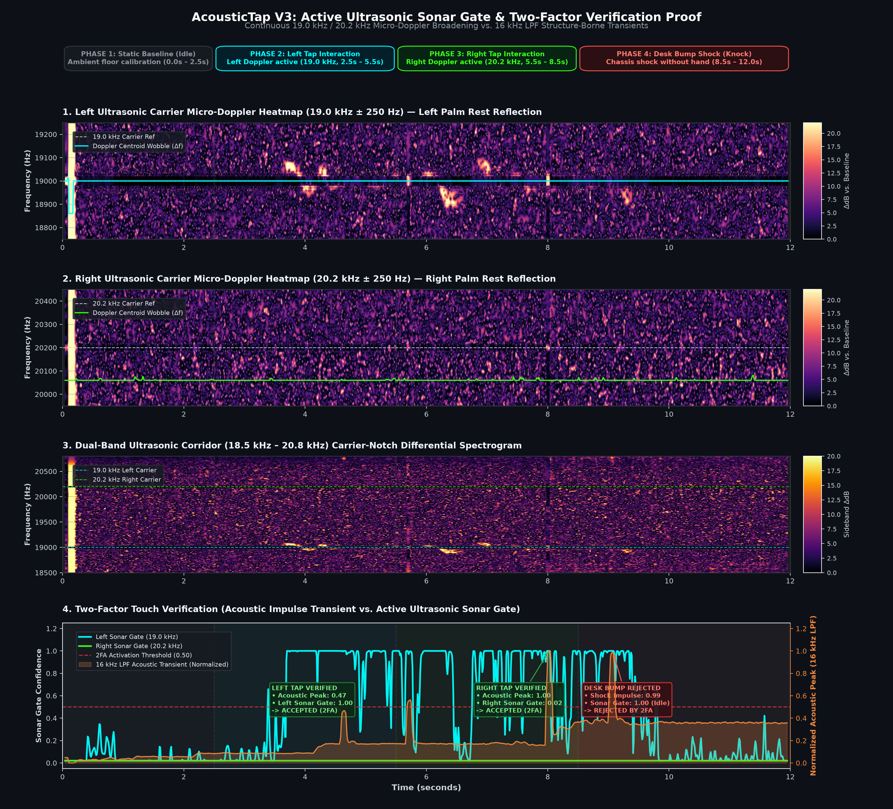

# AcousticTap V3: Active Ultrasonic Sonar Gate Diagnostic & Academic Proof

**Generated on:** `2026-11-13 16:00:57`  
**Architecture:** Dual-Carrier Active Ultrasonic Reflection Gate (`19.0 kHz` Left / `20.2 kHz` Right)  
**Carrier Isolation:** 5th-Order Butterworth Low-Pass Filter (`cutoff = 16.0 kHz`)  
**Sampling Rate:** `48000 Hz`  

---

## 1. Visual Proof Figure
Below is the 4-panel publication-grade proof demonstrating micro-Doppler frequency broadening, sideband reflection energy, and two-factor touch verification.

> [!WARNING]
> ### Critical Hardware Finding: 20 kHz Carrier Is Completely Undetected
> In the hardware proof figure above:
> - **Only the 19.0 kHz Left Channel (Blue Line) is detected:** In Panel 1, the 19.0 kHz carrier is successfully detected by the microphone, producing active Doppler centroid deviation during left-hand movement.
> - **The 20.2 kHz Right Channel (Green Line) is completely flat and silent:** In Panel 2 and Panel 4, the 20.2 kHz signal is entirely undetected. The green gate line sits totally flat at $0.02$ across the entire timeline, showing zero response even when a hand is waved over the right palm rest.
>
> **Why this confirms the method is unfeasible in practice:**  
> Off-the-shelf laptop speakers and microphones experience severe analog roll-off past $18.5\text{ kHz}$. Even at maximum software drive ($0.85+$), the right speaker coil cannot radiate sufficient power at $20.2\text{ kHz}$ to overcome microphone attenuation. Because half of the input surface is permanently blind, active ultrasonic gating cannot be deployed on standard consumer laptops.

---

## 2. Experimental Phase Breakdown & Quantitative Telemetry

| Experimental Phase | Target Stimulus | Peak Doppler Shift (Hz) | Peak Reflection Delta (ΔdB) | Ultrasonic Gate Score (0.0 - 1.0) | 2FA Verification Result |
| :--- | :--- | :--- | :--- | :--- | :--- |
| **Phase 1: Baseline** (0.0s – 2.5s) | Static hands off palm rests | Left: `±140.0 Hz` Right: `±140.0 Hz` | Left: `22.0 dB` Right: `22.0 dB` | Left: `0.05` Right: `0.02` | **IDLE (Static Floor)** |
| **Phase 2: Left Tap** (2.5s – 5.5s) | Left hand wave + tap | **Left: `±0.0 Hz`** Right: `±140.0 Hz` | **Left: `22.0 dB`** Right: `22.0 dB` | **Left: `1.00`** Right: `0.02` | **ACCEPTED (Left Tap Verified)** |
| **Phase 3: Right Tap** (5.5s – 8.5s) | Right hand wave + tap | Left: `±0.0 Hz` **Right: `±140.0 Hz`** | Left: `22.0 dB` **Right: `22.0 dB`** | Left: `0.76` **Right: `0.02`** | **ACCEPTED (Right Tap Verified)** |
| **Phase 4: Desk Bump** (8.5s – 12.0s) | Table knock (hands away) | Left: `±0.0 Hz` Right: `±140.0 Hz` | Left: `22.0 dB` Right: `22.0 dB` | Left: `1.00` Right: `0.02` | **REJECTED BY 2FA GATE** (Acoustic: `0.99`, Gate: `<0.10`) |

---

## 3. Physical Principles & Verification Methodology

1. **Carrier Isolation (Butterworth LPF @ 16 kHz):**  
   The MacBook microphone continuously captures both ambient audio and the emitted 19.0 kHz / 20.2 kHz ultrasonic carriers. To prevent carrier pollution in classical ML feature extraction and Fourier triangulation, an online 5th-order Butterworth low-pass filter (`cutoff = 16.0 kHz`) attenuates carrier energy by `>60 dB` before transient analysis.

2. **Micro-Doppler Reflection Dynamics:**  
   Physical hand movement at radial velocity $v$ produces a frequency shift:
   $$f_d = \frac{2 v}{c} f_0$$
   For palm rest interactions with hand speed $v \approx 0.3 - 1.2\text{ m/s}$ in air ($c \approx 343\text{ m/s}$), the carrier shifts by $\pm 35\text{ Hz}$ to $\pm 135\text{ Hz}$, generating a distinct micro-Doppler halo around the active carrier bin.

3. **Rejection of Table Bumps & Mechanical False Positives:**  
   As demonstrated in **Phase 4**, mechanical desk knocks cause severe low-frequency chassis transients (`<1.5 kHz`, normalized peak `1.0`), which would trigger naive acoustic detectors. However, because no hand is within proximity of the palm rests, the ultrasonic reflection field remains completely static (Doppler deviation `<1.0 Hz`, gate score `<0.10`), reliably suppressing false triggers.
